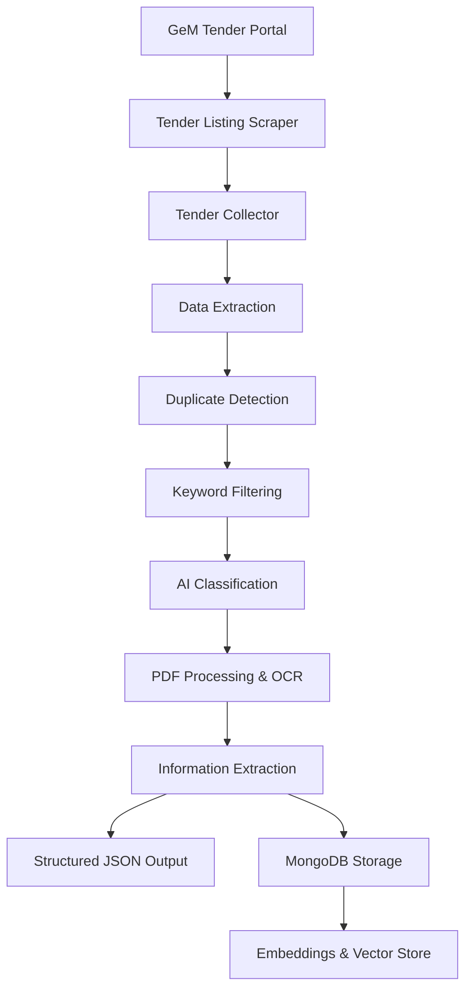

# Software Tenders Classification
### AI-Powered Government Tender Discovery & Classification System

An intelligent Python-based tender discovery and classification system that automates the collection, processing, filtering, and analysis of government procurement opportunities, with a focus on identifying software and IT-related tenders published on the Government e-Marketplace (GeM).

The platform combines web scraping, keyword-based filtering, AI-assisted classification, PDF extraction, OCR, and MongoDB integration to transform unstructured tender information into structured and searchable data.

---

## Project Overview

Government procurement portals publish thousands of tenders across different industries and sectors. Finding relevant software and IT opportunities manually requires considerable time and effort.

**Software Tenders Classification** aims to automate this process through an intelligent data processing pipeline that:

- Collects tender information from GeM.
- Extracts tender details and metadata.
- Identifies software and IT-related opportunities.
- Uses AI-assisted analysis to understand tender requirements.
- Downloads and processes tender documents.
- Detects duplicate records.
- Stores structured tender information.
- Generates classified tender datasets.

## Key Features

### 1. Automated Tender Scraping
- Scrapes tender listings from the GeM portal.
- Supports multi-page tender collection.
- Extracts tender details and associated information.
- Collects newly published opportunities.

### 2. Software & IT Tender Classification
- Identifies software and IT-related tenders.
- Uses keyword-based filtering.
- Applies AI-assisted tender classification.
- Analyses tender descriptions and requirements.

### 3. AI-Powered Information Extraction
- Extracts relevant information from tender descriptions.
- Processes unstructured tender content.
- Uses structured schemas and prompts.
- Generates AI-understood tender information.

### 4. PDF Processing & OCR
- Downloads tender-related PDF documents.
- Extracts text from PDF files.
- Supports OCR-based processing.
- Processes document content for further analysis.

### 5. Duplicate Detection
- Identifies previously collected tender records.
- Prevents unnecessary duplicate processing.
- Separates new tender opportunities from existing records.

### 6. MongoDB Integration
- Stores structured tender information.
- Organises records using database collections and repositories.
- Supports database indexing and data management.
- Includes embedding and vector storage modules.

### 7. Automated Processing Pipeline
- Tender collection.
- Data extraction.
- Data processing.
- Duplicate detection.
- AI classification.
- Document processing.
- Structured output generation.
- Database integration.

---

## Technology Stack

| Component | Technology |
|---|---|
| Programming Language | Python |
| Web Scraping | Selenium / Playwright |
| AI Processing | LLMs, Prompt Engineering |
| Classification | Keyword-based & AI-assisted |
| Document Processing | PDF Parsing, OCR |
| Database | MongoDB |
| Vector Processing | Embeddings & Vector Store |
| Data Format | JSON |
| Version Control | Git & GitHub |

---

## Project Architecture



---

## Project Structure

```text
Software-tenders-Classification/
│
├── app/
│   │
│   ├── ai/
│   │   ├── classifier.py
│   │   ├── extractor.py
│   │   ├── keywords.py
│   │   ├── prompts.py
│   │   └── schemas.py
│   │
│   ├── api/
│   │   ├── detail_client.py
│   │   ├── gem_client.py
│   │   ├── listing_scraper.py
│   │   └── pdf_client.py
│   │
│   ├── database/
│   │   ├── collections.py
│   │   ├── embeddings.py
│   │   ├── indexes.py
│   │   ├── models.py
│   │   ├── mongodb.py
│   │   ├── repository.py
│   │   └── vector_store.py
│   │
│   ├── parser/
│   │   ├── field_extractor.py
│   │   ├── html_parser.py
│   │   ├── ocr.py
│   │   └── pdf_parser.py
│   │
│   ├── pipeline/
│   │   ├── collector.py
│   │   ├── deduplicator.py
│   │   ├── downloader.py
│   │   ├── processor.py
│   │   └── scheduler.py
│   │
│   └── utils/
│       ├── constants.py
│       ├── helpers.py
│       ├── logger.py
│       └── retry.py
│
├── output/
│   ├── ai_understanding.json
│   ├── all_tenders.json
│   └── software_tenders.json
│
├── pdfs/
│   └── Downloaded tender PDF documents
│
├── .gitignore
├── README.md
├── requirements.txt
├── runner.py
└── test_save_mongodb.py
```

---

## Installation & Setup

### Prerequisites

- Python installed on your system.
- MongoDB instance (if using database functionality).
- Required AI API credentials (if AI functionality is enabled).
- Git.

### 1. Clone the Repository

```bash
git clone https://github.com/Kiranravi80/Software-tenders-Classification.git
```

### 2. Navigate to the Project Directory

```bash
cd Software-tenders-Classification
```

### 3. Create a Virtual Environment

```bash
python -m venv venv
```

Activate on Windows:

```powershell
venv\Scripts\activate
```

### 4. Install Dependencies

```bash
pip install -r requirements.txt
```

### 5. Configure Environment Variables

Create a `.env` file in the project root directory.

Add the environment variables required by the application. Refer to `app/config.py` and the relevant configuration modules for the actual variable names.

**Important:** Never commit API keys, database credentials, or other sensitive information to GitHub.

### 6. Run the Project

```bash
python runner.py
```

---

## Generated Outputs

The application generates structured JSON files for tender collection and analysis.

| File | Purpose |
|---|---|
| `all_tenders.json` | Collected tender records |
| `software_tenders.json` | Filtered software and IT tenders |
| `ai_understanding.json` | AI-processed tender information |

Downloaded tender documents are organised separately inside the `pdfs/` directory.

---

## Core Modules

| Module | Responsibility |
|---|---|
| `app/ai/` | AI classification, extraction, prompts and schemas |
| `app/api/` | GeM scraping, tender details and PDF clients |
| `app/database/` | MongoDB, repositories, embeddings and vector storage |
| `app/parser/` | HTML, PDF, OCR and field extraction |
| `app/pipeline/` | Collection, deduplication, downloading and processing |
| `app/utils/` | Logging, helpers, constants and retry mechanisms |
| `runner.py` | Project execution entry point |

---

## Future Enhancements

- Integration with additional government procurement portals.
- Advanced semantic search across tender documents.
- RAG-powered tender document question answering.
- Automated tender notifications and alerts.
- Tender deadline and eligibility tracking.
- Advanced analytics and reporting dashboard.
- Intelligent tender recommendations.
- Historical tender analysis and opportunity insights.

---

## Disclaimer

This project is developed for educational, research, and tender discovery purposes.

Tender information should always be verified against the official procurement portal and original tender documents. This project is not affiliated with or officially endorsed by the Government e-Marketplace (GeM).

---

## Author

**Kiran Ravi Kumar**

AI & Machine Learning Engineer

- GitHub: [@Kiranravi80](https://github.com/Kiranravi80)
- Project Repository: [Software Tenders Classification](https://github.com/Kiranravi80/Software-tenders-Classification)

---

**Built with Python, AI, and intelligent data processing.**


